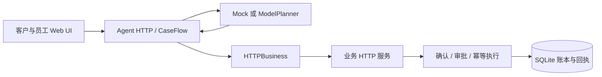

# CaseFlow · 可审计的售后 AI Agent

CaseFlow 是一个面向 AI Agent 与 Python 后端工程实践的个人项目：模型理解售后诉求、查询证据并产生结构化决策，可信业务服务负责确认、审批和事务提交。订单、退款、取消及人工工单均通过真实 HTTP 接口和 SQLite 持久化；所有商店数据和支付操作都是合成演示。

基于 MIT 开源项目 [langgraph-support-agent](https://github.com/nitanandsinghupw/langgraph-support-agent) 增量开发。`support_agent` 属于上游；本项目的工程增量主要位于 `src/caseflow/`，归属见 [UPSTREAM_CHANGES](UPSTREAM_CHANGES.md)。

## 可以查看的工程能力

- **模型与受限规划**：ModelPlanner 接入 OpenAI-compatible Chat Completions；支持 DeepSeek JSON 决策、本地严格 Schema、工具参数校验、超时、有限修复和调用预算。模型只能选择读工具或提出操作提案。
- **独立业务系统**：Agent 经 HTTPBusiness 调用本地业务 HTTP 服务，覆盖订单、物流、退款资格、取消、部分退款和客服工单。业务副作用只有一个 SQLite 真值来源。
- **可信执行与恢复**：提案绑定金额、币种、订单版本和 digest；用户逐项确认，高额退款由员工审批。持久账本、幂等键和唯一回执支持重试、审批恢复及故障分析。
- **人工闭环与 Trace**：审批和人工接管分别建模。工单持久化、员工处理后可继续对话；任务详情展示模型步骤、工具结果、审批和实际回执。
- **效果核查**：保留真实模型冒烟的成功与失败，使用业务账本判定结果。历史 Mock 评测可复现；新的独立真实模型评测尚未运行，任务与 Gold 暂不公开。



## 三分钟本地演示

建议 Python 3.13。Windows 环境已实际验证；Linux CI 已配置，其远端运行状态见 [发布检查](docs/PUBLICATION_REPORT.md)。在项目根目录运行：

```powershell
python scripts/check_public_snapshot.py --allow-git
python -m venv .venv
.\.venv\Scripts\python.exe -m pip install -r requirements-lock.txt
.\.venv\Scripts\python.exe -m caseflow web --directory .local/demo --port 8000
```

macOS/Linux 对应使用 `.venv/bin/python`。浏览器打开 `http://127.0.0.1:8000`。默认 **Mock 模式，无需 API Key 或本地模型**；启动两个本地 HTTP listener，业务状态真实写入数据库。

1. 在客户页面选择合成客户 C100，输入：`1001退款60 EUR，1004取消`。
2. 核对每项提案的订单和金额，分别确认。取消生成回执，60 EUR 退款进入审批。
3. 在员工页面选择合成员工，审批退款；任务详情可查询实际回执和 Trace。
4. 新建会话输入 `快递丢失，请转人工`，员工接受并处理工单；客户追问 `工单处理结果？`。

再次使用同一目录会保留业务状态。需要新演示时换目录，例如 `.local/demo-2`。这些身份入口仅用于显式 Mock 演示。词法 Mock 的自然语言能力有限，不能据此判断真实模型能力。

## 实际验证到了哪里

| 验证范围 | 状态 |
|---|---|
| 业务 HTTP、确认、审批、账本、幂等、工单、故障回归 | 有自动化测试；公开快照实测记录见发布检查 |
| Web/Mock | 实际后端与页面资产已连接，支持交互式演示 |
| DeepSeek `deepseek-flash` | 已完成两轮真实接口/业务冒烟，共36请求、12次任务运行 |
| 跨轮订单证据修复 | 共享协议明确证据仅当前用户轮有效，增加一次有界查询后重新规划；仅离线验证 |
| 新独立真实模型评测 | 已准备24条任务，尚未运行；全部任务、Gold、评分器及专项执行器暂不公开 |
| 正常 Web 入口的真实模型完整售后演示 | 尚未完成专项真实验证 |
| 真实支付、企业CRM、生产SSO、多租户、SLA | 未实现 |

两轮真实冒烟使用相同的3条已见开发任务、两种共享安全底座的规划策略：

| 轮次 | 测试源码 | Baseline | Improved | 实际请求 |
|---|---|---|---|---:|
| 首次冒烟 | bd62170 | 0/3 | 3/3 | 17 |
| v1.2-contract复测 | df68336 | 3/3 | 2/3 | 19 |

首次结果暴露单/批提案 Schema 分支及订单证据契约问题。复测中 Improved 正确理解5 EUR金额，但没有在补齐金额轮重新查询订单，系统转人工且未退款。两个结果均保留。样本只有3条已见任务，且两策略共用 Proposal、确认、审批和执行器，**不能据此声称Improved成功率更高，或单独证明Proposal机制收益**。

详见 [RESULTS](RESULTS.md) 和 [脱敏实验摘录](docs/evidence/historical-smoke.json)。公开摘录经过字段筛选，移除了请求标识、个人元数据、完整Prompt和原始运行文件；完整原件保留在私有开发仓库。

## 测试与阅读入口

```powershell
python -m pytest -q -p no:cacheprovider
python -m support_agent.evaluate
python -m caseflow.agent_eval --mode mock --split all --strategy both --output .local/mock-results.json
python -m caseflow demo
```

严格源树检查放在安装和运行之前；本地运行会产生已被.gitignore排除的环境、数据库和缓存。`--allow-git`仅适用于用户自己的新clone，公开交付快照本身不含.git。

公开的 `data/agent_eval_v1.json` 是已观察的32条历史 Mock 任务，其 `heldout` 字段只是原有分组标签；它不属于尚未运行的新独立评测。上述 Mock runner 通过真实业务HTTP和SQLite运行，两策略的词法模型忽略策略Prompt，不能推导算法收益。[评测说明](docs/EVALUATION.md)

代码阅读建议：`planner.py` → `service.py` → `gateway.py` / `business_api.py` → `repository.py` / `ledger.py` / `execution.py`。业务权限与金额计算由Python处理，模型无数据库写权限。架构与边界见 [ARCHITECTURE](ARCHITECTURE.md)。

## 真实模型配置

`agent --mode live` 使用同一 Agent/HTTP 业务路径和现有 UI；默认演示不会启动它。需要用户自行安全配置 `CASEFLOW_BASE_URL`、`CASEFLOW_MODEL`、`CASEFLOW_API_KEY`，以及业务服务共用的身份签名密钥、服务密钥。示例模板不含任何凭证，CLI不会自动加载 `.env`。

显式 `CASEFLOW_ALLOW_PAID=1` 才能创建真实适配器。正常服务另有进程级请求数与费用预留检查；进程重启不构成账号硬消费上限。请按自己的授权和预算使用，不要把 Key、签名令牌或原始运行日志提交到 Git。本次公开整理没有新增付费调用；专项冒烟执行器及未运行独立评测的私有文件不在公开包内。

这是合成业务个人作品。MIT 许可证与上游版权保留，尚未接入真实商户、支付或企业客户。
